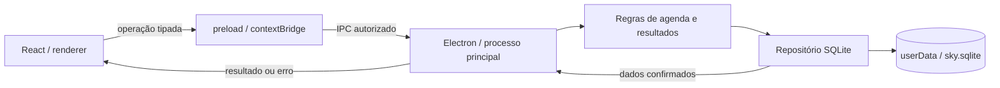

# Arquitetura — O Céu é o Limite

**Versão:** 1.8 · **Atualização:** 28/10/2026 · **Status:** Fases 1–7 validadas; Fase 8 com artefatos/testes locais e aceite externo pendente

## 1. Estrutura e tecnologias

Aplicativo desktop monousuário, com banco local e sem servidor. O processo principal do Electron possui a conexão SQLite e os arquivos. O renderer React apresenta a interface e solicita operações por uma ponte tipada.

| Camada | Tecnologia definida | Situação do protótipo |
| --- | --- | --- |
| Aplicativo Windows | Electron + TypeScript | Abertura e reinício comprovados no Electron |
| Interface | React + TypeScript | Presente |
| Estilos | Tailwind CSS e tokens de design | Plugin Vite, tokens e tema escuro implementados; layout CSS existente reaproveitado |
| Banco | SQLite local, via `sql.js` com WASM empacotado | Esquema v4: base v2/v3 preservada, objetivos e preferências; migrações v1/v2/v3 com backup |
| Gráficos | Recharts | Séries diárias e mensais offline, com lacunas, tooltip e tabela acessível |
| Testes de unidade e integração | Vitest | 106 cenários aprovados, incluindo preservação, cancelamentos, aliases e falhas de backup |
| Testes de interface desktop | Playwright para Electron | 13 fluxos anteriores e três fluxos dos executáveis aprovados |
| Empacotamento | electron-builder, portable + NSIS | Dois executáveis 1.0.0 x64 gerados, recursos conferidos, sem assinatura de editor |

Versões exatas pertencem ao `package.json` e ao lockfile. Evitar atualizar dependências durante implementação de regras de negócio sem motivo e verificação próprios.

## 2. Caminho de uma alteração

O renderer nunca monta SQL nem escolhe o caminho do banco. O main valida remetente, parâmetros, datas e regras de vigência, executa a transação e confirma a gravação. Só então a interface atualiza o estado como salvo. Falhas mantêm a edição disponível e exibem uma mensagem útil.

Não introduzir uma API HTTP local, autenticação ou serviço remoto para essa comunicação.

## 3. Responsabilidades e diretórios

| Local | Responsabilidade |
| --- | --- |
| `electron/main.ts` | Ciclo de vida, janela, diretórios, diálogos nativos e registro de handlers |
| `electron/preload.ts` | Métodos específicos da ponte, sem expor `ipcRenderer` diretamente |
| `electron/database.ts` | Repositório, abertura versionada, operações compatíveis com a interface e transações |
| `electron/backup.ts` | Orquestração exclusiva de backup, escolhas nativas, validação antes da confirmação e descarte do candidato |
| `electron/storage/backupFiles.ts` | Caminhos protegidos, leitura limitada, exportação atômica, cópia anterior independente e mensagens de erro |
| `electron/storage/` | Esquemas v2–v4, cadeia de migrações, validação, materialização e gravação atômica |
| `src/theme.css` | Tokens Tailwind, tema escuro/roxo e adaptação dos componentes existentes |
| `src/components/GoalForm.tsx` | Cadastro/revisão, seleção de dias e vigência com validação na interface |
| `src/components/GoalsPage.tsx` | Metas ativas/arquivadas, filtros e ações de gestão |
| `src/components/GoalHistory.tsx` | Consulta das versões vigentes, encerradas e não aplicadas |
| `src/components/DailyChecklist.tsx` | Agenda por data, avaliação, estados explícitos e acesso aos registros |
| `src/components/ProgressSummary.tsx` | Progresso diário, total diário da semana e resumo semanal separado |
| `src/components/RestPlanner.tsx` | Planejamento/remoção de descanso com validação e proteção de dias avaliados |
| `src/components/OutcomeDialogs.tsx` | Confirmação de correções e consulta da trilha de resultados |
| `src/components/EvolutionPage.tsx` | Filtros, calendário de consistência, categorias, resumos e comparações |
| `src/components/ProgressCharts.tsx` | Gráficos Recharts compartilhados pelo início/evolução, lacunas e tabela acessível |
| `src/components/RoutinePreview.tsx` | Fonte, seleção/adaptação de atividades, período explícito e confirmação de repetição |
| `src/components/RoutinesPage.tsx` | Catálogo, experiências, comparação pessoal, escolhas originais e legado |
| `src/components/JourneyPage.tsx` | Conquistas, níveis, objetivos, preferências e resumo da visão geral |
| `src/components/LongTermGoalForm.tsx` | Formulário e progresso manual dos objetivos independentes |
| `src/components/StoragePanel.tsx` | Exportar, restaurar, abrir pasta, mensagens persistentes e guia de recuperação offline |
| `src/components/Modal.tsx` | Janela modal compartilhada, foco nativo e cancelamento controlado |
| `src/goals.css` | Layout e estados dos componentes de metas |
| `src/checklist.css` | Estados da agenda, descanso, progresso e histórico de resultados |
| `src/analytics.css` | Gráficos, calendário, tabelas e layout das análises |
| `src/routines.css` | Prévia, personalização e histórico de experiências |
| `src/journey.css` | Paletas Violeta/Oceano/Floresta, foco e componentes do caminho pessoal |
| `src/backup.css` | Painel de dados, cartões, caminhos e estados de backup |
| `shared/types.ts` | Contratos serializáveis; tipos de domínio independentes de componentes |
| `shared/domain.ts` | Regras puras de datas, períodos, elegibilidade e cálculo |
| `shared/schedule.ts` | Dias da semana, rótulos e fronteiras válidas de vigência, usados pelo main e pelo formulário |
| `shared/checklist.ts` | Estados do dia, resumos, fechamento de períodos e consulta de avaliações |
| `shared/analytics.ts` | Séries, agregações por contagem, comparação de semanas, meses e estados do calendário |
| `shared/routines.ts` | Catálogo offline versionado, IDs estáveis de atividades, fontes e datas de consulta |
| `shared/routineRuns.ts` | Validação de escolhas, intervalos, sobreposição, anotações e progresso de experiências |
| `shared/journey.ts` | Pontos, níveis, marcos e melhor sequência derivados dos resultados atuais |
| `shared/personalization.ts` | Preferências, paletas e validação dos objetivos de longo prazo |
| `shared/backup.ts` | Limite de 50 MB, prévia e resultados serializáveis de exportação/restauração |
| `electron/storage/routineRuns.ts` | Leitura das cópias persistidas de experiências |
| `electron/storage/personalization.ts` | Projeção dos objetivos e preferências do SQLite |
| `src/` | Navegação, componentes, formulários, estados de carregamento e falha |
| `tests/` | Testes de regras, banco temporário e fluxo Electron |
| `scripts/` | Desenvolvimento, build e artefatos |
| `scripts/prepare-licenses.mjs` | Textos locais das licenças dos 45 componentes de produção |
| `scripts/prepare-release.mjs` | Hashes, notas, guia e instruções derivados dos executáveis reais |
| `scripts/verify-release.mjs` | Integridade dos anexos, runtime x64 e recursos/conteúdo do ASAR |
| `scripts/create-sandbox.mjs` | Configuração opcional do Windows Sandbox offline, com distribuição montada somente para leitura |
| `tests/release/` e `playwright.release.config.ts` | Testes do portátil real, instalação isolada, diálogos Win32 e renderer escalado |

A Fase 2 extraiu formulário, gestão e histórico de metas de `src/App.tsx`, que continua coordenando navegação, checklist e demais recursos. As próximas extrações devem acompanhar as fases correspondentes, sem reestruturar funções que não participam da entrega.

A Fase 3 extraiu também o checklist, os resumos e os diálogos de descanso/resultado. `Snapshot` expõe `dayPlans` e `events` existentes no SQLite. Resultados de períodos encerrados passam por confirmação e usam a mesma operação transacional de registro; eventos mantêm a ordem de gravação, inclusive quando os horários são iguais. Resumos diários devolvem percentual nulo em descanso, futuro e ausência de agenda; a interface não renderiza uma barra de desempenho nesses casos. Semanas usam um compromisso por meta e não contaminam a barra diária. A ordem do checklist segue a criação das metas, e o foco por teclado permanece no controle após salvar.

`Snapshot` inclui revisões e ocorrências e preserva a projeção `goals`/`entries` dos componentes existentes. Agora também inclui os dias da definição e `canDelete`, calculado pelo main a partir de resultados e eventos. `goalsOn` lê cópias históricas para o passado/presente e projeta a programação vigente para o futuro, sem gravar resultados antecipados. O formulário usa as mesmas fronteiras de vigência do repositório; o main revalida todos os campos e a elegibilidade para excluir. Metas arquivadas conservam a definição da data de arquivamento, sem ativar revisões futuras não aplicadas. O esquema v2 e seu checksum não mudaram na Fase 2.

## 4. Decisões registradas

| ID | Decisão | Motivo e consequência |
| --- | --- | --- |
| AD-01 | Offline e um banco por usuário do sistema operacional | Dispensa conta/servidor; não oferece sincronização automática |
| AD-02 | SQLite via `sql.js` no processo principal | Reaproveita o protótipo e evita extensão nativa; é necessário exportar e gravar o banco após cada transação |
| AD-03 | Revisões de metas e ocorrências com cópias históricas | Mudanças futuras não recalculam o passado usando a definição atual |
| AD-04 | Semanal separada da diária | Evita sete contagens da mesma obrigação |
| AD-05 | Datas locais para agenda; instantes UTC para auditoria | Evita conversões que deslocam o dia; fuso fica registrado na ocorrência |
| AD-06 | Tema inicial escuro com roxo | Segue a referência visual mais recente do usuário |
| AD-07 | Fases com critérios e evidência registrados | Protótipos ou builds isolados não aprovam automaticamente uma fase |
| AD-08 | Atualização manual por download no primeiro lançamento | Dispensa infraestrutura e fluxo de atualização automática no MVP |
| AD-09 | Experiências são cópias imutáveis de modelos e escolhas, com chave de operação | Catálogo pode mudar sem reescrever o histórico; repetição da solicitação não duplica metas |
| AD-10 | Pontos/conquistas derivados e objetivos em tabela separada | Correções não acumulam recompensas; progresso manual não altera ocorrências nem pontos |
| AD-11 | Validar antes da confirmação e guardar cópia independente anterior à restauração | Cancelar não grava; a cópia `.pre-restore-...` permanece disponível após gravações normais, sem depender da `.bak` rotativa |
| AD-12 | Portátil e NSIS usam o mesmo pacote e identidade | Pasta de dados fora da instalação; instalador por usuário, sem exclusão de dados por padrão ou atualização automática |

### 4.1 Limites da persistência escolhida

`sql.js` mantém o banco em memória. Para o volume pessoal inicial, a simplicidade de distribuição compensa a exportação integral a cada gravação. Toda mutação passa por um único serviço de escrita sequencial: transação, exportação, escrita temporária, sincronização do arquivo e substituição do banco. Em caso de falha, recuperar também o estado em memória.

Antes de trocar a estratégia por um driver nativo, medir abertura e gravação com histórico representativo. Se o tamanho do banco comprometer a experiência, registrar uma decisão e uma migração específica; não manter dois drivers em paralelo sem necessidade.

## 5. Histórico, agenda e consultas

A base v2/v3 preservada no esquema v4, documentada em [BANCO_DE_DADOS.md](BANCO_DE_DADOS.md), diferencia definição, revisão vigente, ocorrência de um período e alteração de resultado. As consultas de evolução leem ocorrências com seus atributos históricos, nunca apenas a versão atual de `goals`.

Ocorrências passadas ainda não abertas são materializadas de forma idempotente ao recuperar o intervalo, respeitando as revisões e a programação vigentes naquele momento. Arquivamento é um limite temporal: não impede recuperar períodos anteriores. Consultas são limitadas ao intervalo solicitado e nunca criam obrigações antes do início da meta.

A abertura materializa o histórico elegível até hoje e a semana atual. Na Fase 4, a evolução filtra o `Snapshot` existente localmente, sem novos canais IPC, SQL no renderer ou gravação de estatísticas derivadas. A mesma regra de agenda serve ao materializador e às consultas; não são criadas obrigações anteriores ao início das metas.

Uma versão futura de uma meta pode existir antes de sua vigência. O usuário vê a definição atual e a próxima alteração programada; a agenda continua usando a revisão correta para cada período.

As análises da Fase 4 reutilizam `opportunities`, `dailySummary` e `streak`. Percentuais agregados usam somas de contagens; diferenças entre semanas usam proporções brutas. Semanais são contadas uma vez por semana que intersecta o filtro e nunca entram nas séries diárias/mensais. Comparações usam duas semanas encerradas; semana/mês atuais são parciais. Recharts usa `connectNulls=false`, eixo 0–100, animação desativada e tabela expansível como alternativa textual. O contêiner limita o SVG durante o redimensionamento para evitar rolagem horizontal enquanto o observador atualiza a largura. Recharts 3.10.1 foi adicionado com versão exata e lockfile; o pacote local do renderer passa a aproximadamente 655 kB minificado, sem downloads em execução. O build informa esse tamanho; divisão de bundle não foi necessária para os fluxos offline validados.

Na Fase 5, `RoutinePreview` permite selecionar/adaptar atividades antes de chamar `startRoutine`. O main valida modelo/versão, campos, início hoje/futuro, intervalo até 31 dias e sobreposição de experiências. Uma operação normalizada é persistida com chave única; reenvios equivalentes devolvem a mesma experiência. Uma repetição intencional em datas sobrepostas exige confirmação explícita na prévia e é revalidada pelo main. A transação cria experiência e compromissos pontuais em conjunto, com reversão em memória e no arquivo em caso de falha.

SQLite v3 é aditivo: apenas `routine_runs` e seu índice, sem modificar a base/checksum v2. A migração valida uma cópia, compara as tabelas anteriores, grava/reabre o candidato e só depois substitui o ativo; mantém backup `.pre-v3-...` dos bytes originais. A abertura/importação v1 usa a cadeia 1→2→3. Rotinas anteriores permanecem legadas. O `Snapshot` preserva `routineId` como modelo e acrescenta a experiência e suas anotações, usadas também no checklist. `RoutinesPage` consulta cópias imutáveis, mostra compromissos futuros/dispensados/retirados e compara as duas últimas experiências encerradas do modelo escolhido. Fontes atuais ou previamente salvas só abrem por ação explícita e autorização do main.

Na Fase 6, `journeySummary` lê compromissos elegíveis do histórico: 10 pontos por resultado atingido e uma oportunidade por meta/período. A melhor sequência histórica percorre somente dias com obrigações diárias, ignorando descanso e folgas; dias encerrados elegíveis sem conclusão interrompem a sequência daquele momento. Nenhum saldo de recompensas ou evento de desbloqueio é persistido, portanto repetir cliques, abrir a tela ou desfazer/refazer uma avaliação não infla pontos. Os seis marcos e os cinco limites de nível ficam explícitos na interface.

`long_term_goals` é independente de `goals` e `goal_occurrences`: progresso manual, unidade, alvo, prazo e arquivamento não geram obrigações ou pontos. A criação usa operação idempotente, e o main revalida valores e limites. `personal_preferences` guarda uma única preferência de tema/incentivo. O renderer aplica cores somente após a confirmação de gravação. Controles de preferência usam bloqueio por estado/`aria-disabled`, mantendo foco durante o IPC. Paletas usam tokens em `journey.css`; categorias e ilustrações mantêm cores semânticas próprias. Gráficos acompanham o destaque do tema.

SQLite v4 acrescenta duas tabelas, preservando conteúdo e checksums v2/v3. `upgradeToCurrent` encadeia conversões em cópias, fecha intermediárias e devolve um candidato para gravação/reabertura/validação antes de substituir o ativo. A origem v3 ganha backup `.pre-v4-...` exato; origens v1/v2 conservam os padrões anteriores de backup. A prévia IndexedDB pode salvar aparência; objetivos e garantias de histórico permanecem no desktop SQLite.

## 6. Contratos de comunicação

Operações previstas: consultar agenda/intervalo, criar meta, revisar meta, arquivar, excluir meta elegível, registrar/corrigir resultado, planejar descanso, listar/copiar rotina, consultar evolução e exportar/restaurar backup.

Cada operação aceita um objeto tipado e retorna dados confirmados ou erro estruturado. Validar novamente no main: TypeScript e validação visual não protegem chamadas de IPC em tempo de execução. Não expor métodos genéricos de executar SQL, ler qualquer arquivo ou abrir qualquer URL.

IDs são estáveis. Escritas repetidas de resultado atualizam a mesma ocorrência. Copiar rotina usa um identificador de operação para evitar duplicação por cliques ou tentativas repetidas.

Na Fase 7, `exportBackup()` devolve `{ path, savedAt, bytes }` e `importBackup()` devolve `{ snapshot, recoveryPath, restoredAt, sourceVersion }`; `null` significa cancelamento. `openDataFolder()` abre somente a pasta fixa do banco e não recebe caminho do renderer. Esses métodos mantêm os canais específicos e a validação de remetente, frame principal e URL exata. Enquanto `BackupService.busy` estiver ativo, outros canais de dados são recusados, inclusive `load`, que pode materializar ocorrências. Apenas informações da pasta, abertura dessa pasta e fontes previamente autorizadas continuam disponíveis. A interface bloqueia repetição e suspende recargas por foco/data durante a operação.

## 7. Segurança e recuperação

- `contextIsolation: true`, `sandbox: true`, `nodeIntegration: false`.
- Conteúdo da interface e assets locais; navegação não autorizada e novas janelas bloqueadas.
- Content Security Policy restrita; conexões de desenvolvimento removidas do pacote final.
- `frame-src 'none'` impede conteúdo em frames no renderer; fontes, ícones e estilos necessários são locais.
- Solicitações de permissão negadas por padrão; links do catálogo passam por validação antes de abrir no navegador.
- Arquivo no diretório do usuário, nunca em `Program Files`, pasta temporária do portátil ou repositório.
- Uma instância gravadora; transações serializadas. Banco com versão superior à suportada abre com erro explicativo, sem rebaixar ou sobrescrever.
- Falha de abertura não cria silenciosamente um banco vazio por cima do arquivo existente.
- Backups e migrações validam integridade e preservam o arquivo de origem até confirmação completa.

O banco não é criptografado no MVP. Acesso por outro processo com as mesmas permissões de usuário e sincronização de pastas pertencem ao ambiente local; não anunciar proteções que o app não implementa.

`BackupService` mantém exclusividade desde a escolha do arquivo até sucesso, falha ou cancelamento. `prepareImport` lê bytes já limitados a 50 MB, verifica cabeçalho/versão, migra em banco isolado, valida regras e projeta o `Snapshot` antes da confirmação. A confirmação nativa começa em Cancelar e mostra caminho, versão e quantidades. Os bytes validados ficam congelados para a restauração, sem reler a origem após a confirmação. Cancelar fecha o candidato sem escrever.

Confirmada a troca, o repositório prepara o resultado, salva e confere os bytes exatos do ativo em `.pre-restore-<data>-<id>.sqlite` e usa a gravação atômica já existente, com reabertura/validação do candidato. Só depois troca a conexão e retorna o resultado. A `.bak` comum pode continuar rotativa; se ela for a origem selecionada, não é sobrescrita nessa restauração. A cópia independente permanece e não há retenção automática. A projeção aceita explicitamente o banco candidato para não misturar histórico do ativo na prévia ou no resultado.

Exportação valida o banco, protege caminhos/aliases dos arquivos internos e grava um temporário exclusivo ao lado do destino. Sincroniza, confere os bytes e só então renomeia. Falha conserva o destino anterior e remove apenas o temporário dessa operação quando possível. O painel informa erros de permissão, espaço e arquivo ausente, sem anunciar sucesso antes da confirmação de gravação.

O [guia de recuperação](docs/RECUPERACAO.md) explica também a substituição manual de uma cópia válida com o aplicativo fechado. A falha de abertura mostra a pasta real e instruções de preservação; não há reset automático do banco. Esquema v4, checksums e dependências permanecem inalterados nesta fase.

## 8. Identidade visual

Nome: **O Céu é o Limite**. Assinatura: **Disciplina hoje. Evolução sempre.** A imagem enviada é uma referência de direção, não uma captura do código atual.

| Token | Valor inicial | Uso |
| --- | --- | --- |
| Fundo | `#0D1424` | Janela e área principal |
| Superfície | `#1D2940` | Cartões e lista de metas |
| Superfície elevada | `#26334D` | Campos, menus e estados de foco |
| Primária | `#7C6BFF` | Ações, seleção e progresso |
| Primária clara | `#ADA3FF` | Linha de gráfico e detalhes |
| Texto | `#F4F6FC` | Títulos e conteúdo principal |
| Texto secundário | `#B6C1D5` | Descrições e legendas |
| Sucesso | `#35D697` | Metas atingidas |
| Atenção | `#F4B75E` | Pendências e lembretes |
| Não atingida | `#F18E9C` | Resultado explícito, sem tom punitivo |

Usar tipografia local legível, hierarquia clara e ícones consistentes. Texto principal de pelo menos 14 px, secundário de 12 px, alvos de clique confortáveis, navegação por teclado e movimento reduzido conforme preferência do sistema. Verificar contraste dos pares reais; a paleta não substitui a verificação de acessibilidade.

Início: saudação/mensagem breve, metas de hoje com fração e barra, sequência com explicação, checklist e evolução dos últimos sete dias. Sidebar pode organizar o espaço desktop maior, preservando a hierarquia da referência. Números de exemplo, como 8/10 ou 12 dias, nunca aparecem como dados pessoais reais.

## 9. Estratégia de verificação

- Vitest: datas, vigência, programação, denominadores, arredondamento, intervalos semanais, descanso e sequências.
- Integração SQLite: gravação/reabertura, migração v1→v2, falhas de escrita, restauração e invariância do histórico.
- Playwright/Electron: abrir, criar, avaliar, encerrar processo, reabrir e comparar resultados. Testar o app desktop, não apenas a prévia do navegador.
- Backup: SQLite e arquivos reais, falhas de escrita e cancelamentos. Nos testes Electron, controlar somente respostas dos diálogos/shell, sem caminhos ou ramificações de teste no produto. Conferir negação de remetente estrangeiro, novas janelas, navegação e links; após navegação cancelada, conferir o documento comprometido no `webContents`, a interface e IPC autorizado.
- Distribuição: portátil e NSIS em usuário de Windows sem Node.js; abrir offline, atualizar mantendo o banco e testar escala de tela.

O comando de build não prova um fluxo visual, e um teste de unidade não prova um executável. Registrar exatamente a evidência obtida em cada marco, conforme [PROGRESSO.md](PROGRESSO.md).

## 10. Distribuição da Fase 8

`package.json` configura portátil/NSIS x64 com nomes distintos. O instalador é por usuário, `deleteAppDataOnUninstall=false`, `runAfterFinish=false` e idioma pt-BR. `app.setAppUserModelId` usa a mesma identidade `br.app.oceueolimite` do builder antes de abrir janelas. O nome interno e o uso de `userData` permanecem os mesmos; não há diretório especial para dados do portátil nem alteração de esquema. A edição dos recursos PE aplica ícone/metadados de versão; nenhum certificado de editor foi usado, e `Get-AuthenticodeSignature` confirmou `NotSigned` nos dois anexos.

O ASAR inclui renderer, main/preload e dependências locais. `sql-wasm.wasm`, `RECUPERACAO.md` e licenças acompanham `resources`. Os 45 textos de licença de produção vêm da árvore instalada/lockfile, sem busca na execução do app. A verificação rejeita bancos/arquivos de teste dentro do pacote e compara o WASM com a dependência travada. O renderer mantém aproximadamente 699 kB minificado e o aviso de tamanho já existente; não exige downloads em execução.

O teste de distribuição usa `--user-data-dir` nativo e `PATH` sem Node.js, sem mudar o código de produção para teste. O lançador NSIS portátil é iniciado como processo real e sua interface é conectada por CDP local; o instalado usa o conector Electron do Playwright. Os diálogos reais são operados por controles Win32 identificados pelo PID da própria aplicação, com caminhos em perfil temporário. Instalação/reinstalação/desinstalação ficam em `.test-data`; o helper verifica as chaves NSIS das visões de Registro e recusa instalação pessoal/atalho preexistente. Um teste de dados nessa pasta não substitui o aceite dos caminhos padrão em uma máquina limpa.

O modelo `docs/github-actions/release.yml.example`, quando ativado em `.github/workflows/release.yml`, constrói/testa e armazena os oito anexos. Apenas uma solicitação manual em tag correspondente à versão pode criar um rascunho, em trabalho separado com `contents: write`; tag push não publica. A autenticação desta publicação não possui escopo `workflow`: o modelo foi preservado sem ativar a automação. Não há token no código. Windows limpo, escala do sistema, atualização entre versões publicadas e execução do workflow remoto permanecem pendentes. Procedimento em [LANCAMENTO.md](docs/LANCAMENTO.md).
