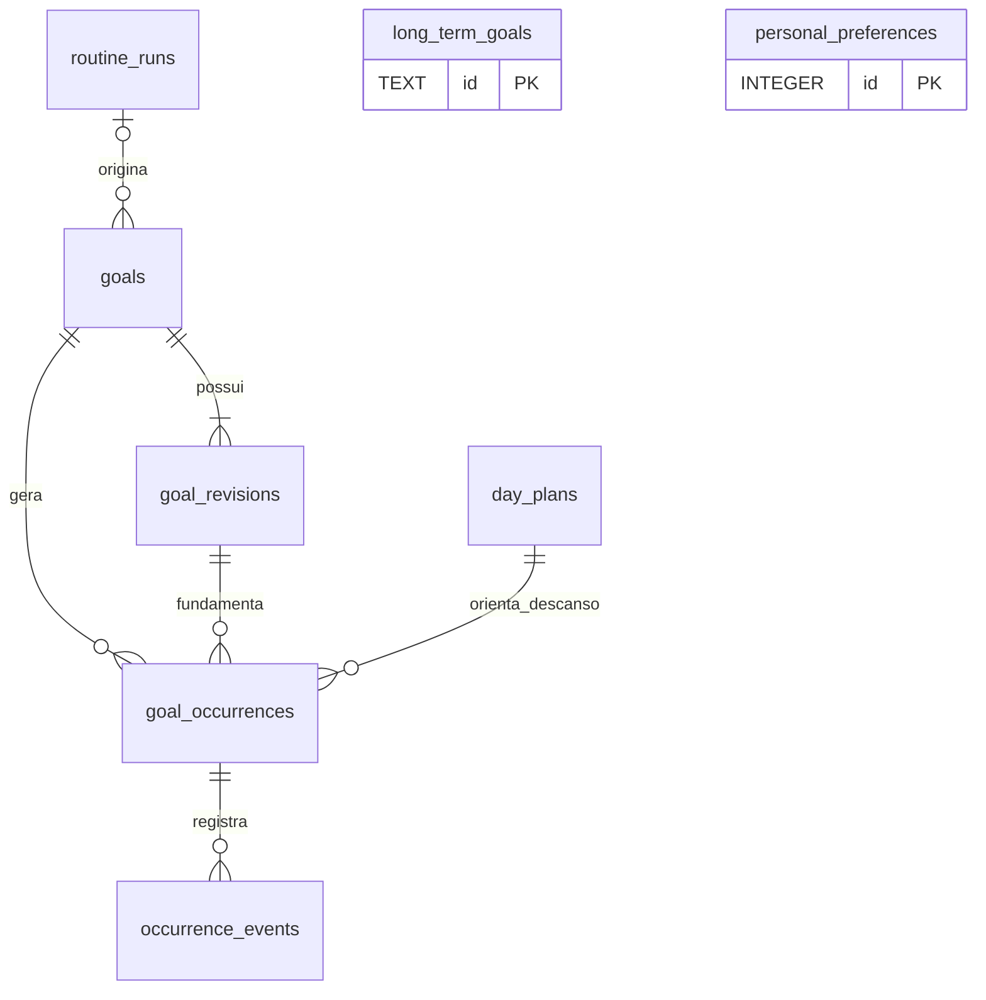

# Banco de dados — O Céu é o Limite

**Versão da especificação:** 1.8 · **Atualização:** 28/10/2026

## 1. Situação atual e destino

O protótipo inicial possuía SQLite v1 com `goals` e `entries`, sem revisões ou cópias históricas. A Fase 1 implementou o esquema v2 em [electron/storage/schema.ts](electron/storage/schema.ts), com seis tabelas de base, e a migração em [electron/storage/migrations.ts](electron/storage/migrations.ts).

O banco atual é v4, com nove tabelas. Preserva a base e os checksums v2/v3, incluindo `routine_runs`, e acrescenta `long_term_goals` e `personal_preferences` na Fase 6. Os três blocos SQL abaixo descrevem essa composição. Não executá-los diretamente sobre um banco existente: o aplicativo identifica a versão, migra em cópias separadas e preserva o original até a conferência completa.

Local definitivo: `path.join(app.getPath('userData'), 'sky.sqlite')`. O app consulta o caminho em tempo de execução e o mostra em “Meus dados e backups”. Portátil e instalador compartilham identidade e diretório. Nenhum banco pessoal entra no Git.

Fase 8 não muda esquema, checksums, migrações ou localização. O instalador NSIS é por usuário e declara `deleteAppDataOnUninstall=false`. Portátil/instalado foram alternados com um perfil temporário compartilhado, sem gravação concorrente; reinstalação, restauração e reabertura após desinstalar conservaram o conjunto de dados. Essa prova isolada não usa a pasta pessoal padrão; Windows limpo e atualização entre versões publicadas continuam pendentes. Consulte [LANCAMENTO.md](docs/LANCAMENTO.md).

## 2. Conceitos e relacionamentos



O vínculo entre `day_plans` e ocorrências é por data e regra de domínio, sem chave estrangeira direta. O catálogo de rotinas fica no pacote; uma experiência copia seus dados para `routine_runs`. O vínculo da experiência com suas metas é lógico e validado pelo repositório. Isso mantém intactas as tabelas v2 e as rotinas legadas.

| Entidade | Responsabilidade |
| --- | --- |
| `schema_migrations` | Versões aplicadas e identificação da migração |
| `goals` | Identidade estável e fim da vigência |
| `goal_revisions` | Definição que vale em um intervalo de datas |
| `goal_occurrences` | Compromisso de um dia/semana com atributos congelados |
| `occurrence_events` | Alterações explícitas de resultado, com data da correção |
| `day_plans` | Descanso planejado para uma data local |
| `routine_runs` | Aplicação de um modelo e sua versão, sem depender do catálogo atual |
| `long_term_goals` | Objetivos com progresso manual, separados da agenda e dos pontos |
| `personal_preferences` | Tema e preferência de incentivo, uma linha por banco |

## 3. Contrato SQL v2 do MVP

Aplicar `PRAGMA foreign_keys = ON` a cada conexão. `PRAGMA user_version` é atualizado apenas dentro da migração bem-sucedida; a abertura recusa versões superiores às suportadas.

```sql
PRAGMA foreign_keys = ON;

CREATE TABLE schema_migrations (
  version INTEGER PRIMARY KEY,
  name TEXT NOT NULL,
  checksum TEXT NOT NULL,
  applied_at TEXT NOT NULL
);

CREATE TABLE goals (
  id TEXT PRIMARY KEY,
  created_at TEXT NOT NULL,
  archived_from TEXT,
  origin_kind TEXT NOT NULL DEFAULT 'personal'
    CHECK (origin_kind IN ('personal', 'routine')),
  origin_reference TEXT
);

CREATE TABLE goal_revisions (
  id TEXT PRIMARY KEY,
  goal_id TEXT NOT NULL REFERENCES goals(id) ON DELETE RESTRICT,
  revision_number INTEGER NOT NULL CHECK (revision_number >= 1),
  title TEXT NOT NULL CHECK (length(trim(title)) BETWEEN 1 AND 100),
  description TEXT NOT NULL DEFAULT '' CHECK (length(description) <= 500),
  category TEXT NOT NULL CHECK (category IN ('Pessoal', 'Saúde', 'Estudos', 'Trabalho')),
  frequency TEXT NOT NULL CHECK (frequency IN ('daily', 'weekly', 'once')),
  weekday_mask INTEGER NOT NULL DEFAULT 0,
  effective_from TEXT NOT NULL,
  effective_to TEXT,
  created_at TEXT NOT NULL,
  CHECK (effective_to IS NULL OR effective_to > effective_from),
  CHECK (
    (frequency = 'daily' AND weekday_mask BETWEEN 1 AND 127)
    OR (frequency IN ('weekly', 'once') AND weekday_mask = 0)
  ),
  UNIQUE (goal_id, revision_number),
  UNIQUE (goal_id, effective_from),
  UNIQUE (goal_id, id)
);

CREATE TABLE day_plans (
  local_date TEXT PRIMARY KEY,
  kind TEXT NOT NULL CHECK (kind = 'rest'),
  note TEXT NOT NULL DEFAULT '',
  timezone TEXT NOT NULL,
  created_at TEXT NOT NULL,
  updated_at TEXT NOT NULL
);

CREATE TABLE goal_occurrences (
  id TEXT PRIMARY KEY,
  goal_id TEXT NOT NULL REFERENCES goals(id) ON DELETE RESTRICT,
  revision_id TEXT NOT NULL,
  period_kind TEXT NOT NULL CHECK (period_kind IN ('day', 'week')),
  period_start TEXT NOT NULL,
  period_end_exclusive TEXT NOT NULL,
  eligible_from TEXT NOT NULL,
  timezone TEXT NOT NULL,
  title_snapshot TEXT NOT NULL,
  description_snapshot TEXT NOT NULL DEFAULT '',
  category_snapshot TEXT NOT NULL,
  frequency_snapshot TEXT NOT NULL CHECK (frequency_snapshot IN ('daily', 'weekly', 'once')),
  origin_snapshot TEXT,
  disposition TEXT NOT NULL DEFAULT 'scheduled'
    CHECK (disposition IN ('scheduled', 'rest', 'cancelled')),
  status TEXT NOT NULL DEFAULT 'pending'
    CHECK (status IN ('pending', 'done', 'missed')),
  recorded_at TEXT,
  created_at TEXT NOT NULL,
  updated_at TEXT NOT NULL,
  FOREIGN KEY (goal_id, revision_id)
    REFERENCES goal_revisions(goal_id, id) ON DELETE RESTRICT,
  UNIQUE (goal_id, period_kind, period_start),
  CHECK (period_end_exclusive > period_start),
  CHECK (eligible_from >= period_start AND eligible_from < period_end_exclusive),
  CHECK (disposition = 'scheduled' OR status = 'pending'),
  CHECK (period_kind != 'week' OR frequency_snapshot = 'weekly'),
  CHECK (frequency_snapshot != 'weekly' OR period_kind = 'week')
);

CREATE TABLE occurrence_events (
  id TEXT PRIMARY KEY,
  occurrence_id TEXT NOT NULL REFERENCES goal_occurrences(id) ON DELETE RESTRICT,
  previous_status TEXT NOT NULL CHECK (previous_status IN ('pending', 'done', 'missed')),
  next_status TEXT NOT NULL CHECK (next_status IN ('pending', 'done', 'missed')),
  changed_at TEXT NOT NULL,
  change_reason TEXT NOT NULL CHECK (change_reason IN ('checklist', 'history_correction')),
  CHECK (previous_status != next_status)
);

CREATE INDEX revisions_by_goal_and_date
  ON goal_revisions(goal_id, effective_from, effective_to);
CREATE INDEX occurrences_by_period
  ON goal_occurrences(period_kind, period_start, disposition, status);
CREATE INDEX occurrences_by_category
  ON goal_occurrences(category_snapshot, period_start);
CREATE INDEX events_by_occurrence
  ON occurrence_events(occurrence_id, changed_at);
```

Datas de agenda são strings ISO `YYYY-MM-DD`; instantes são ISO UTC completos. A validação de datas reais, fuso reconhecido, limites de texto e tipos ocorre no main antes do SQL. Não depender de comparação textual para validar um dia inexistente.

`effective_to` é exclusivo. O serviço fecha a revisão anterior e insere a nova na mesma transação, recusando intervalos sobrepostos. Frequência e programação não podem criar uma ocorrência diária dentro de uma semana já pertencente à mesma meta semanal.

Máscara dos dias: segunda = 1, terça = 2, quarta = 4, quinta = 8, sexta = 16, sábado = 32, domingo = 64. Segunda/quarta/sexta = 21. Todos os dias = 127. A conversão para índices JavaScript fica em uma função testada; não espalhar essa conta pelos componentes.

## 4. Contrato de rotina, acrescentado na Fase 5

```sql
CREATE TABLE routine_runs (
  id TEXT PRIMARY KEY,
  operation_key TEXT NOT NULL UNIQUE,
  template_id TEXT NOT NULL,
  template_version INTEGER NOT NULL CHECK (template_version >= 1),
  name_snapshot TEXT NOT NULL,
  principle_snapshot TEXT NOT NULL,
  source_label_snapshot TEXT NOT NULL,
  source_url_snapshot TEXT NOT NULL,
  source_checked_on TEXT NOT NULL,
  activities_snapshot_json TEXT NOT NULL,
  starts_on TEXT NOT NULL,
  ends_on TEXT NOT NULL,
  created_at TEXT NOT NULL,
  request_json TEXT NOT NULL,
  CHECK (ends_on >= starts_on)
);
CREATE INDEX runs_by_template_and_dates
  ON routine_runs(template_id, starts_on, ends_on);
```

`operation_key` torna uma solicitação repetida idempotente. `request_json` guarda a entrada normalizada: a mesma operação com as mesmas escolhas devolve a experiência já salva, inclusive após reiniciar ou atualizar o catálogo; usar a chave com outras escolhas é recusado. Uma nova experiência intencional recebe outra chave e precisa de `allowRepeat=true` quando suas datas cruzam uma aplicação anterior do mesmo modelo, inclusive legado.

`activities_snapshot_json` guarda nome, descrição, categoria, horário opcional, minutos opcionais, anotação pessoal de ritmo e a lista de IDs/datas dos compromissos de cada atividade. São dados JSON, nunca código. Cada atividade selecionada gera uma meta `once` por dia do intervalo, limitado a 31 dias. Início de novas experiências é hoje ou futuro; o padrão da interface é só hoje. Ocorrências futuras só são materializadas quando o dia chega e nunca diminuem o desempenho antes disso.

Em novas cópias, `goals.origin_reference` e `goal_occurrences.origin_snapshot` guardam o ID da experiência. A projeção `Snapshot` mantém `routineId` como ID do modelo para compatibilidade e acrescenta `routineRunId` e `routineActivity`. Cópias antigas continuam com o ID do catálogo, sem reescrita ou versão presumida. A validação confere período, campos, IDs únicos e correspondência com as revisões existentes. A exclusão elegível de uma meta não apaga as escolhas originais da experiência: o relatório identifica compromissos retirados, sem fingir que foram cumpridos.

Nome, princípio, versão, rótulo/URL da fonte e data de consulta são cópias imutáveis. Atualizar o catálogo não atualiza experiências. A origem permanece consultável no histórico mesmo quando o modelo muda; a abertura do link exige clique do usuário e validação no main.

### 4.1 Objetivos e preferências, acrescentados na Fase 6

```sql
CREATE TABLE personal_preferences (
  id INTEGER PRIMARY KEY CHECK (id = 1),
  theme TEXT NOT NULL CHECK (theme IN ('violet', 'ocean', 'forest')),
  show_encouragement INTEGER NOT NULL CHECK (show_encouragement IN (0, 1)),
  updated_at TEXT NOT NULL
);
CREATE TABLE long_term_goals (
  id TEXT PRIMARY KEY,
  operation_key TEXT NOT NULL UNIQUE,
  title TEXT NOT NULL CHECK (length(trim(title)) BETWEEN 1 AND 100),
  description TEXT NOT NULL CHECK (length(description) <= 500),
  category TEXT NOT NULL CHECK (category IN ('Pessoal', 'Saúde', 'Estudos', 'Trabalho')),
  target_value REAL NOT NULL CHECK (target_value >= 1 AND target_value <= 1000000000),
  current_value REAL NOT NULL CHECK (current_value >= 0 AND current_value <= target_value),
  unit TEXT NOT NULL CHECK (length(trim(unit)) BETWEEN 1 AND 30),
  due_on TEXT,
  archived_at TEXT,
  created_on TEXT NOT NULL,
  created_at TEXT NOT NULL,
  updated_at TEXT NOT NULL,
  create_request_json TEXT NOT NULL
);
```

A migração/criação inicializa uma única preferência `id=1`, tema `violet`, incentivo habilitado e instante de atualização. O main exige exatamente essa linha e valida enumeração/booleano. O renderer usa o estado confirmado; falha de escrita conserva o tema anterior e não aparenta uma alteração salva.

Objetivos não referenciam `goals` nem geram ocorrências/eventos. São acompanhamento quantitativo informado pelo usuário, sem pontos ou efeito no denominador diário/semanal. O progresso atual fica entre zero e o alvo; o prazo é opcional. Criar um objetivo ou escolher um novo prazo não admite uma data encerrada, mas um objetivo com prazo passado pode ter seu progresso atualizado mantendo o prazo original. Arquivar conserva seus valores e bloqueia edição até reativar. Não há exclusão definitiva nesta fase.

`operation_key` e `create_request_json` preservam a solicitação original normalizada, mesmo após editar o objetivo. Reenvio equivalente devolve o registro existente; reutilizar a chave com outra entrada falha. Valores, unidade, datas, timestamps e JSON são validados na abertura/importação antes da substituição. O progresso manual é o valor atual, sem uma trilha de versões quantitativas nesta fase.

Pontos, níveis e conquistas não têm tabela ou saldo acumulado. São derivados dos resultados elegíveis existentes: 10 pontos por compromisso atingido e uma contagem por meta/período. Correções, descansos e futuras ocorrências usam as mesmas regras do domínio. Reabrir ou repetir uma avaliação não cria recompensas adicionais.

## 5. Operações e invariantes

### Criar e recuperar agenda

1. Criar identidade e primeira revisão em uma transação.
2. Resolver a revisão vigente para cada período elegível até a data local de hoje.
3. Aplicar programação, data de início, arquivamento e descanso.
4. Materializar somente o intervalo necessário, com chave única por meta/período.
5. Guardar os atributos da revisão na ocorrência, inclusive se ainda estiver pendente.

Para uma meta semanal iniciada na quarta, `period_start` é a segunda daquela semana e `eligible_from` é a quarta. Consultas de segunda/terça não mostram uma obrigação anterior à criação. A semana seguinte usa segunda como início e elegibilidade.

Metas futuras são consultadas como planejamento derivado da definição. Não materializar resultados futuros nem permitir marcar sua conclusão antecipadamente.

### Registrar resultado

Atualizar `status`, `recorded_at` e `updated_at` e inserir o evento na mesma transação. Repetir o mesmo status é uma operação sem mudança e sem evento duplicado. Voltar para pendente mantém a ocorrência e o rastro de alteração, em vez de apagar a evidência de uma correção.

A Fase 3 expõe esses eventos na consulta de registros. A seleção de um período encerrado abre confirmação antes da gravação; a consulta mantém a ordem de inserção dos eventos, sem depender de horários distintos. Resultados migrados sem evento/horário são apresentados como dados legados, sem inventar um instante de conclusão.

O resultado semanal pertence à ocorrência da semana, independentemente de qual dia do calendário originou o clique.

### Editar e arquivar

Criar revisão futura e manter as cópias das ocorrências. A fronteira de vigência segue [REQUISITOS.md](REQUISITOS.md). Arquivar primeiro materializa o período atual; ocorrências atuais sem resultado podem virar `cancelled`. Ocorrências passadas e atuais com resultado ficam preservadas. Não apagar eventos nem trocar atributos de ocorrências antigas.

### Excluir

A exclusão definitiva é elegível apenas quando não há evento nem resultado `done`/`missed`, inclusive se o usuário tiver desfeito uma conclusão depois. Confirmada essa condição, remover ocorrências pendentes/canceladas, revisões e identidade em uma transação. Um banco com histórico não depende de `ON DELETE CASCADE` para uma decisão do produto.

### Planejar descanso

Inserir `day_plans` e marcar as ocorrências diárias elegíveis da data como `rest`, mantendo estado pendente. Não afetar semanais. Recusar mudança retroativa de dia encerrado ou com resultado. Remover descanso de hoje/futuro recoloca a programação válida; o serviço não cria metas que não estavam programadas originalmente.

Implementado na Fase 3. A verificação considera qualquer avaliação diária anterior, inclusive desfeita, e ignora avaliações semanais para essa decisão. Novas metas e rotinas adicionadas a um dia de descanso recebem a dispensa ao materializar. Remoção altera somente ocorrências `rest`, preservando as `cancelled` e metas já excluídas. Observações têm até 500 caracteres. Importação/abertura recusa inconsistência entre descanso e avaliações, antes de substituir o arquivo ativo.

## 6. Consultas e percentuais

- Diárias: filtrar `period_kind = 'day'`, `disposition = 'scheduled'` e `eligible_from <= hoje`, no intervalo. Numerador: `status = 'done'`; denominador: todas as linhas elegíveis.
- Semanais: filtrar `period_kind = 'week'`, sem fazer join que replique uma linha para cada dia. Resumo próprio.
- Categoria e título históricos vêm de campos `*_snapshot`, não do último registro de `goal_revisions`.
- Descanso, cancelamento e ausência de agenda não entram no denominador. “Sem registro” continua pendente e entra se estava programado.
- Série temporal sem denominador devolve valor nulo com motivo, não `NaN`, infinito ou 100%.
- Nunca somar percentuais arredondados para derivar totais.

A Fase 4 implementa essas consultas como funções puras em `shared/analytics.ts`, usando o `Snapshot` já validado pelo main. Não cria tabelas, migrações, índices ou gravações de estatísticas; esquema v2 e checksum permanecem iguais. Filtros de 7/30/90 dias incluem hoje e excluem o futuro; séries sem agenda preservam `null`. Categorias diárias usam as cópias das ocorrências, mesmo após revisão. Semanais que cruzam o intervalo contam uma vez no resumo próprio. Comparações usam duas semanas encerradas; totais mensais usam somente ocorrências diárias nos limites do mês, incluindo fevereiro bissexto. Correções de resultados recalculam todos os indicadores a partir dos mesmos registros, inclusive após reabrir o arquivo.

## 7. Migração v1 → v2

Implementada e comprovada na Fase 1 por testes de integração e pelo fluxo Electron com reinício.

1. Ler versão e validar integridade do v1 sem alterar o arquivo.
2. Copiar o v1 para um backup identificado por versão/data, fora do arquivo temporário de gravação comum.
3. Construir o v2 em banco separado; criar revisões com os atributos atualmente disponíveis.
4. Gerar ocorrências elegíveis desde `start_date` até a data de migração, respeitando frequência, `archived_on` e origem. No v1, metas diárias significavam todos os dias; não inventar folgas.
5. Transferir cada `entry` para sua ocorrência por dia/segunda da semana; manter resultado e IDs de origem quando possível. Não inventar hora da conclusão: `recorded_at` pode permanecer nulo para dados legados.
6. Preservar explicitamente entradas da data de arquivamento se existirem, mesmo que a consulta antiga as ocultasse. Conferir divergências antes de confirmar a migração.
7. Comparar quantidades de metas e de resultados, conferir chaves/relacionamentos, frequências e amostras de totais. Rodar `integrity_check` e `foreign_key_check`.
8. Registrar migração e `user_version = 2` no novo banco; persistir, fechar, reabrir e repetir as verificações antes de substituir o arquivo ativo.
9. Se qualquer etapa falhar, manter v1 ativo e apresentar o erro. Nunca tentar executar o aplicativo antigo sobre um banco v2; uma reversão restaura a cópia v1 com a versão de app compatível.

O v1 não armazena títulos/categorias anteriores à última edição, instantes de conclusão ou descansos. A migração não consegue recuperar fatos inexistentes. Documentar esse limite; preservação de versões completas começa no v2.

O backup de reversão usa `sky.sqlite.pre-v2-<data>-<id>.sqlite` e mantém os bytes exatos do v1. `sky.sqlite.bak` guarda o estado anterior às gravações comuns/restaurações e não sobrescreve a cópia identificada da migração. A nova versão é conferida após gravar e reabrir o arquivo temporário, antes da troca do banco ativo. Após exportar via `sql.js`, o serviço reativa `foreign_keys`, pois a biblioteca reabre a conexão e reinicializa pragmas.

As Fases 2 e 3 implementaram dias programados, revisões com vigência, exclusão elegível, descanso e consulta dos eventos usando as seis tabelas existentes, sem mudança do esquema v2. A compatibilidade com as rotinas do protótipo guarda a origem atual, sem antecipar a tabela de experiências da Fase 5.

Novas metas pessoais não admitem início retroativo; dados históricos já existentes e migrados continuam preservados. Edições podem adiar a vigência; quando há ocorrências e uma das frequências é semanal, a fronteira é uma segunda-feira. Planejamentos ainda futuros podem ser ajustados sem modificar cópias já materializadas. Metas sem qualquer ocorrência admitem correção imediata. Exclusão remove ocorrências sem resultados, revisões e identidade na mesma transação; qualquer evento anterior bloqueia a operação, inclusive após desfazer um resultado. Arquivar mantém ocorrências avaliadas, inclusive desmarcadas, e a consulta da definição fica ancorada na data do arquivamento para não ativar um planejamento posterior.

### 7.1 Migração v2 → v3 — Fase 5

A abertura de v2 cria `sky.sqlite.pre-v3-<data>-<id>.sqlite` com os bytes exatos do original. O repositório valida o v2, clona-o em memória, acrescenta a tabela/índice de experiências e registra a migração 3 com checksum próprio. As cinco tabelas de conteúdo anteriores são comparadas linha a linha; o registro da migração 2 e seu checksum permanecem intactos. Antes de substituir o arquivo ativo, o candidato é gravado, reaberto e validado, incluindo JSON e vínculos de experiências. Falhas conservam o original; a tentativa pode ser repetida.

V1 continua com backup `.pre-v2-...` exato e passa pelas migrações 1→2→3 antes de uma única substituição do arquivo ativo. Importação aceita v1, v2 e v3, valida o candidato atualizado e conserva o banco ativo anterior em `.bak`. Versões futuras ou conteúdo inválido não substituem o ativo.

Para voltar a um aplicativo v2, fechar o v3, guardar uma cópia do banco v3 e restaurar o backup `.pre-v3-...` como `sky.sqlite`, usando a versão compatível. Esse backup representa o momento anterior à migração e não contém alterações feitas depois dela. Para voltar ao aplicativo v1, usar o backup v1 `.pre-v2-...`. Aplicativos antigos devem recusar um banco v3; não há operação concorrente entre esquemas.

Rotinas legadas conservam metas, resultados e origem anterior, sem criar experiências fictícias nem inferir versão, horários ou data de consulta inexistentes. A interface permite consultar esse histórico separadamente.

### 7.2 Migração v3 → v4 — Fase 6

A origem v3 recebe backup `sky.sqlite.pre-v4-<data>-<id>.sqlite` com os bytes exatos do original. A conversão valida e clona o v3, acrescenta somente as duas tabelas pessoais e a migração 4 com checksum próprio. As seis tabelas de conteúdo anteriores são comparadas linha a linha; checksums e registros das migrações 2/3 permanecem intactos. O candidato é gravado, reaberto e validado antes da troca do arquivo ativo. Falha mantém a origem; uma nova abertura pode repetir a operação com segurança.

`upgradeToCurrent` encadeia origens v1/v2/v3 até v4, sem gravar versões intermediárias no arquivo ativo. Origem v1 conserva backup `.pre-v2-...` com bytes v1; origem v2 usa `.pre-v3-...` com bytes v2. As seções anteriores registram os marcos históricos; o destino atual é sempre v4. Importação aceita v1–v4 e preserva o banco ativo anterior, incluindo objetivos e preferências. Na Fase 7, a cópia independente `.pre-restore-...` complementa a proteção `.bak`, conforme a seção seguinte. Não copia linhas entre bancos nem aceita versões futuras.

Para voltar ao aplicativo v3, fechar o v4, guardar uma cópia dele e restaurar o backup v3 `.pre-v4-...` como `sky.sqlite` com a versão compatível. Ele contém somente o estado anterior à migração, sem novas alterações ou personalizações feitas depois. Para versões v2/v1, usar o backup correspondente à origem suportada. Aplicativos antigos recusam v4; não há gravação concorrente entre esquemas.

## 8. Backup e falhas

Fase 7 mantém o esquema v4 com nove tabelas e checksums inalterados. Exportação valida o banco e inclui todo o conjunto: metas, revisões, ocorrências, auditoria, descanso, experiências, objetivos, preferências e versões de migração. `MAX_BACKUP_BYTES` limita exportação e restauração a 50 × 1024 × 1024 bytes. Não há novas dependências.

### Exportação

O destino vem apenas do diálogo nativo. O app recusa o banco ativo, `.bak`, `.tmp` e cópias `.pre-v...`/`.pre-restore-...` da pasta de dados, incluindo aliases por caminho real, junction ou hardlink. Um temporário exclusivo ao lado do destino recebe os bytes, é sincronizado e comparado com a origem antes de renomear. Se a gravação ou renomeação falhar, o destino anterior permanece. Cancelar não escreve. O sucesso retorna o caminho efetivo, o instante e o tamanho, sem depender de um aviso genérico.

### Preparação e confirmação da restauração

1. Escolher arquivo no main e recusar o próprio banco ativo ou seu `.tmp`.
2. Abrir o arquivo, conferir que é regular e seu tamanho antes de alocar, e ler no máximo o tamanho conferido mais um byte. Se ele crescer ou encolher durante a leitura, recusar. Os bytes lidos são a origem congelada da operação.
3. Conferir cabeçalho SQLite, versão 1–4, integridade, chaves estrangeiras, esquema, checksums, campos e limites de domínio. Atualizar origens antigas em banco separado usando a cadeia existente, sem modificar a origem.
4. Materializar o histórico elegível e projetar o `Snapshot` do candidato. A projeção e o cálculo de `canDelete` usam esse mesmo banco, sem consultar acidentalmente o ativo.
5. Só então mostrar a confirmação nativa com caminho, formato, quantidades e aviso de substituição integral. A seleção inicial é **Cancelar**. Cancelar fecha o candidato sem gravar arquivos.

Enquanto a operação aguarda escolha ou confirmação, o main impede outra operação de dados, incluindo carregamentos que possam materializar ocorrências. O renderer não recebe acesso genérico ao sistema de arquivos nem envia caminhos para os canais de backup.

### Substituição e cópia anterior

Após confirmar, o repositório atualiza a materialização do candidato para a data corrente e prepara seu resultado. Antes de trocar o ativo, salva os bytes exatos do arquivo atual em `sky.sqlite.pre-restore-<data>-<id>.sqlite`, com nome exclusivo, sincronização e conferência. Essa cópia não é sobrescrita pelas gravações normais; permite restaurar o estado anterior mesmo após novos registros ou reinício.

O candidato segue a gravação atômica existente, com validação após gravar/reabrir o temporário. Só depois da troca bem-sucedida passa a ser a conexão ativa. A `.bak` continua rotativa; quando ela própria é a origem escolhida, a operação preserva essa origem e usa a cópia independente para proteger o estado anterior. O arquivo selecionado para restaurar não é sobrescrito.

Falhas mantêm banco ativo e origem. Se a falha ocorrer após criar a cópia independente, ela pode permanecer válida na pasta. Erros de permissão, pasta ausente, arquivo em uso e falta de espaço são informados no painel. Não há reset automático do banco, mistura de linhas, rebaixamento para esquema futuro ou sucesso antes da gravação confirmada.

O teste inclui exportar, alterar o conjunto, restaurar, fechar e reabrir, comparar conteúdo completo e recuperar novamente pela cópia anterior. Falhas verificam bytes do ativo e da origem, além do estado em memória. As cópias locais não substituem exportações em outro dispositivo; não existe retenção automática ou criptografia. O procedimento manual quando o app não abre está em [RECUPERACAO.md](docs/RECUPERACAO.md).

## 9. Provas exigidas

- Reabrir sem perda de metas, revisões, ocorrências ou resultados.
- Editar frequência, nome e categoria e comparar os períodos antigos antes/depois.
- Materializar duas vezes sem duplicações, inclusive semana iniciada no meio.
- Alterar resultado semanal em dois dias e continuar com uma ocorrência.
- Simular falha de escrita/migração/restauração e comparar o original byte a byte quando aplicável.
- Migrar fixture v1 com metas arquivadas, rotinas e resultados da data do arquivamento.
- Recusar backup inválido, versão futura e relacionamento inconsistente.
- Conferir que exclusão e descanso não removem histórico de resultados.
